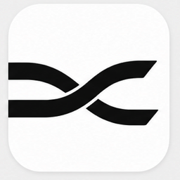
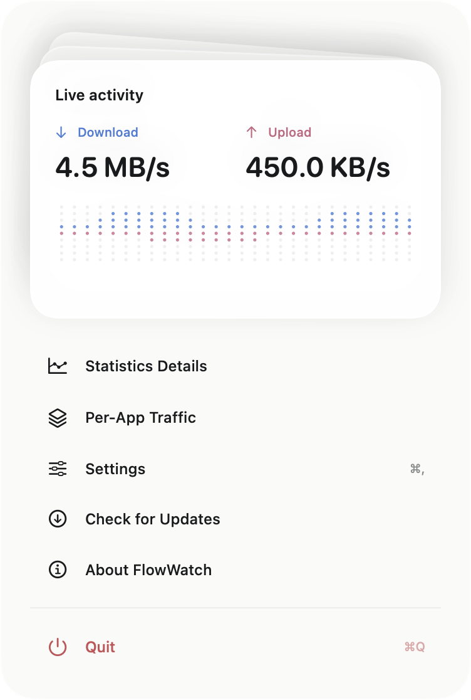
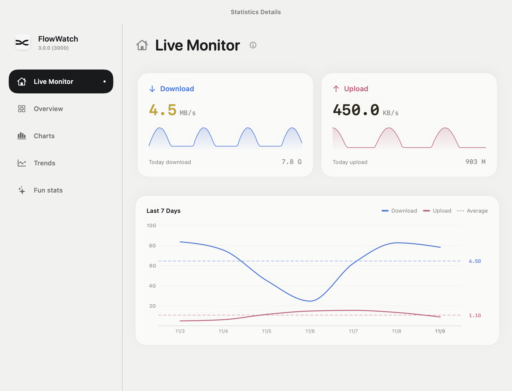
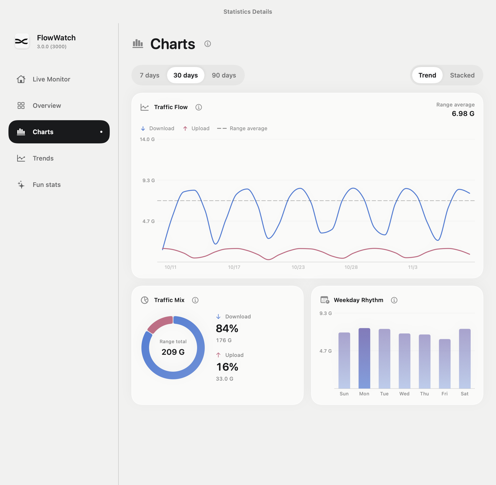
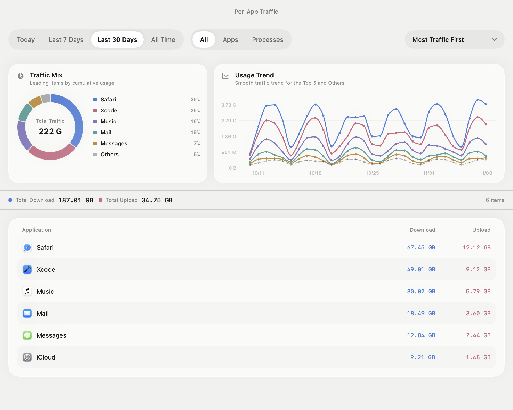
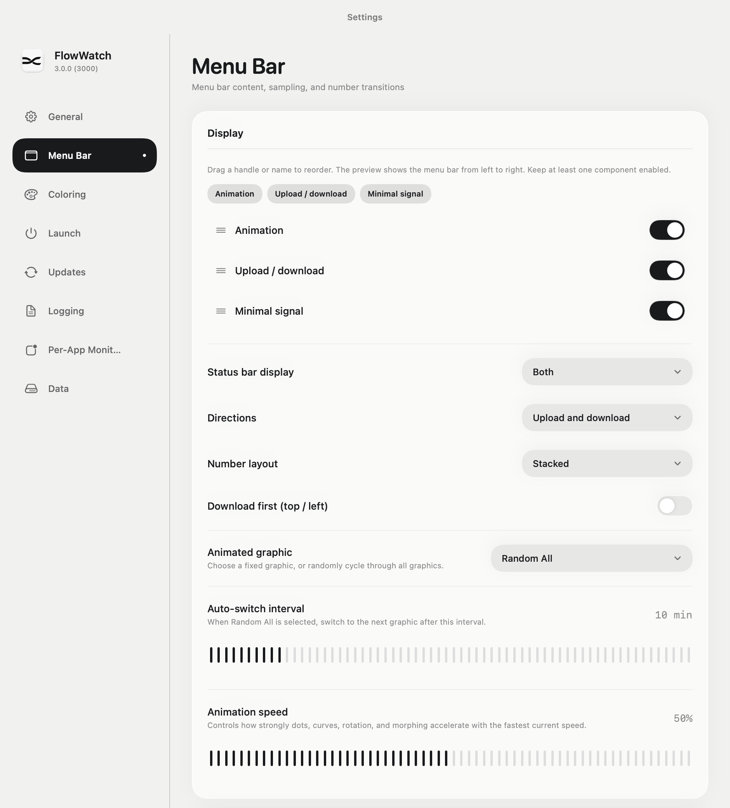

<div align="center">
  
  <h1>FlowWatch</h1>
  <p>A macOS menu bar network monitor for live speed, traffic history, and app usage.</p>
</div>

[简体中文](README.md) | English

> Windows version: [FlowWatch-Win](https://github.com/W1tFzQq08pTv/FlowWatch-Win)

## v3: A new card interface

Check speed in the menu bar, open the cards for a quick summary, and explore the details when you need more context. v3 brings a consistent interface to the quick panel, statistics, app usage, and settings, with light and dark appearances and Chinese and English support.

- **Composable menu bar**: Enable and reorder traffic text, curve animation, and signal components. Choose speed, today's totals, or both; adjust direction order and horizontal or stacked layouts.
- **Three quick cards**: Live speed, today's traffic, and a seven-day summary. Click or swipe horizontally between cards, with direct access to statistics, app usage, and settings.
- **Traffic history**: Five sections cover live monitoring, overview, charts, trends, and fun statistics. Explore 7/30/90-day ranges, switch between lines and stacked bars, and inspect direction shares and weekday patterns.
- **App and process usage**: Enable app monitoring to explore today, the last seven or thirty days, or all history. Filter apps and system processes, sort usage, and compare composition rings with historical trends.
- **Consistent charts**: Blue for downloads, rose for uploads, lighter rings, subtle grids, and clear values. Nonnegative traffic curves stay at or above the zero baseline; averages and tooltips remain readable.
- **Your preferences**: Set separate sampling intervals for network and app monitoring, colors, language, launch at login, and logging. Supported interactions respect the system's Reduce Motion preference.

## Interface preview

Screenshots are captured from the v3 interface using demonstration traffic and app usage data.

### Menu bar quick panel



### Live monitoring and historical charts

| Live monitoring | Traffic charts |
| --- | --- |
|  |  |

### App usage and component settings

| App usage | Menu bar components |
| --- | --- |
|  |  |

## Install and update

Requires **macOS 13 or later**. FlowWatch lives in the menu bar and does not show a Dock icon by default.

### Homebrew

```bash
brew tap w1tfzqq08ptv/flowwatch
brew install --cask flowwatch
```

### Download the DMG

Download `FlowWatch.dmg` from [GitHub Releases](https://github.com/W1tFzQq08pTv/FlowWatch/releases/latest), open it, and drag the app into Applications.

### Built-in updates

FlowWatch checks GitHub Releases and downloads updates in the background, asking before installation and relaunch. Reminders, install-on-quit, and skipping ordinary versions are supported. The built-in updater also works after installation through Homebrew.

## Data and privacy

- Network speed and daily totals come from system interface byte counters. Optional app monitoring uses the system's `nettop` data; it does not read packet content.
- Preferences stay in local UserDefaults. Daily and app history are stored as JSON files in `~/Library/Application Support/FlowWatch/`.
- Logging can be disabled in settings. When enabled, logs stay local, rotate daily, and are retained for seven days.
- No account is required. Traffic statistics are never uploaded or synced; update checks and downloads connect to GitHub.
- Interface totals and app usage use different sampling and accounting methods and may differ. The app list primarily shows usage over external hardware network interfaces.

## Build from source

CI uses Xcode 26.6; the same or a newer version is recommended. Open `FlowWatch.xcodeproj`, select the `FlowWatch` scheme, and run, or use:

```bash
xcodebuild -project FlowWatch.xcodeproj -scheme FlowWatch \
  -configuration Debug -destination 'platform=macOS' build
```

See the [developer notes](FlowWatch/README.md) for source structure and build details.

## Releases

Pushing a `vX.Y.Z` tag triggers the Release workflow. It injects the version, builds the app, creates a DMG, ZIP, and signed Sparkle appcast, then publishes them to GitHub Releases. Signing, notarization, and Homebrew tap updates run when the required credentials are configured.

For a release that must not be skipped, use an annotated tag with `sparkle:critical` on its own line in the tag message. Users can still choose to install it later. A major version bump alone does not require this marker.
