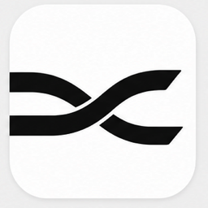
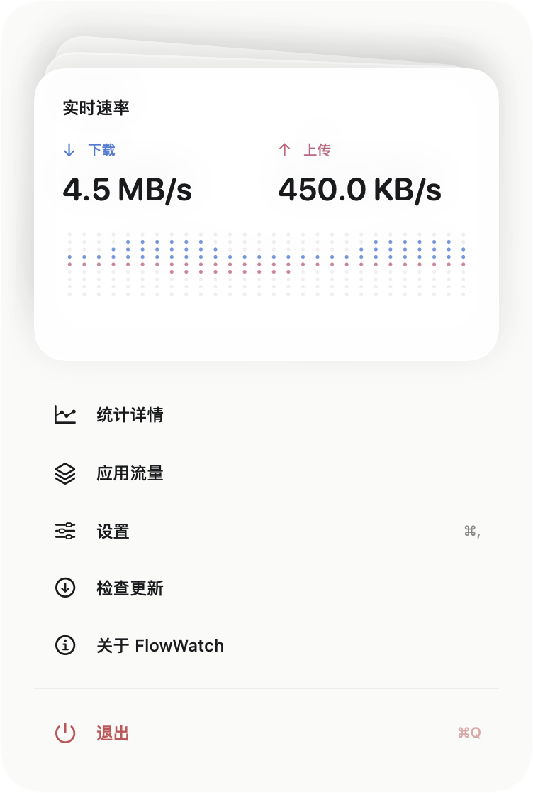
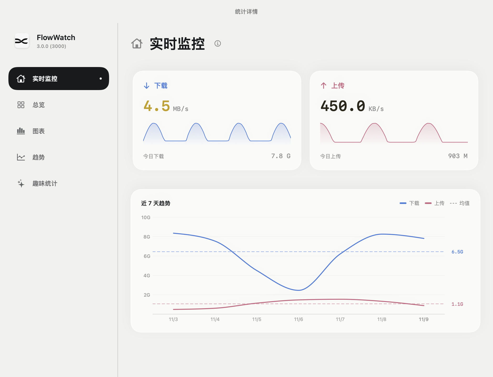
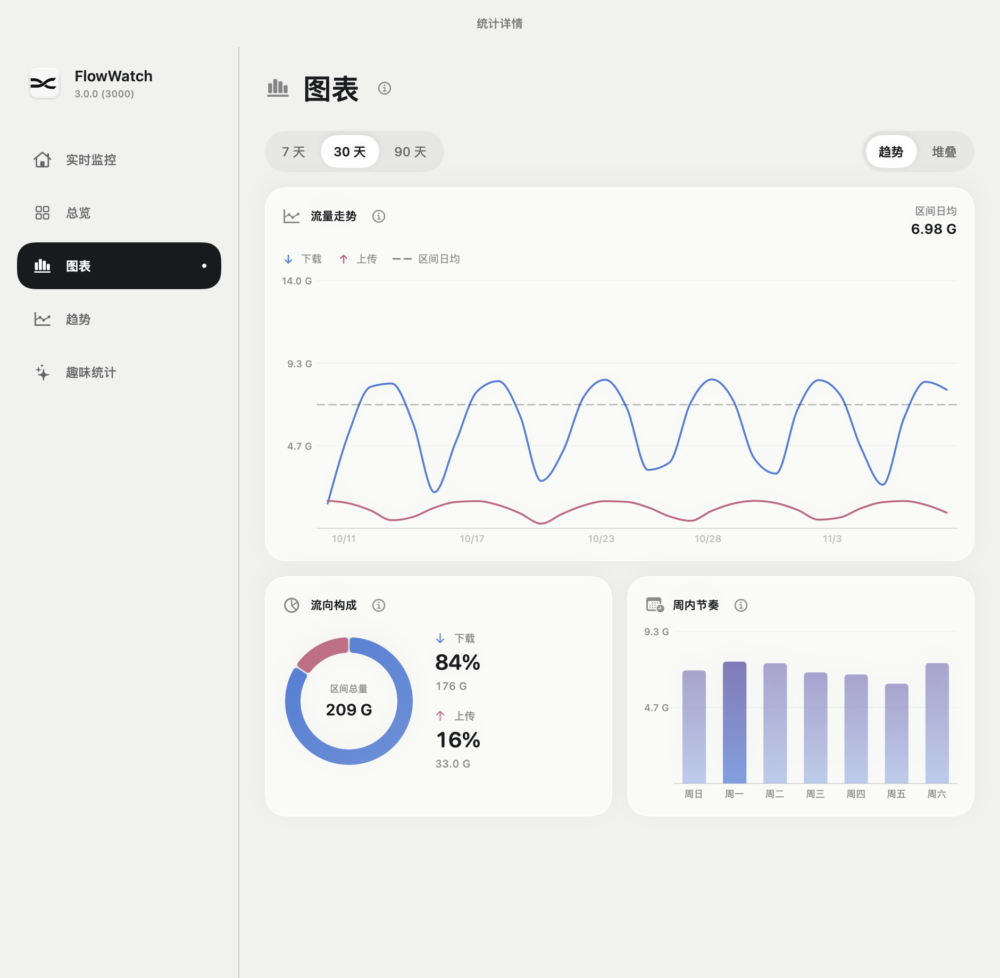
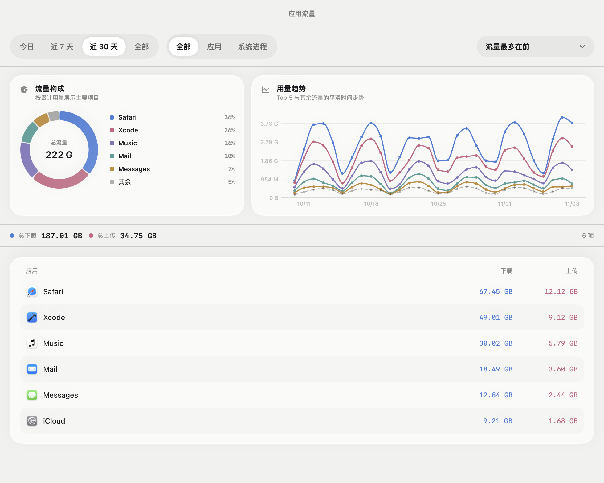
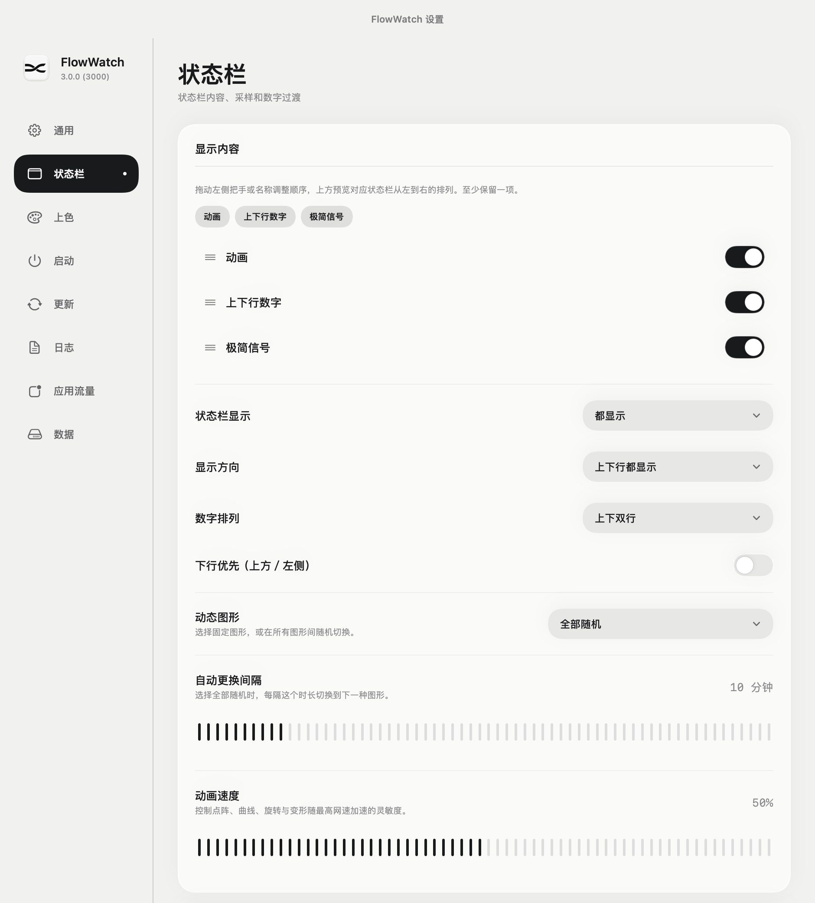

<div align="center">
  
  <h1>FlowWatch</h1>
  <p>macOS 菜单栏网速与流量监控，让实时速率、历史走势和应用用量一目了然。</p>
</div>

简体中文 | [English](README.en.md)

> Windows 版本：[FlowWatch-Win](https://github.com/W1tFzQq08pTv/FlowWatch-Win)

## v3：全新的卡片界面

菜单栏随时看速率，点开卡片回顾流量，再进入详情了解变化。v3 统一了快捷面板、统计、应用流量和设置的视觉与交互，支持浅色、深色及中英文界面。

- **可组合的菜单栏**：独立开关、排序流量文字、曲线动画与信号组件；选择速率、今日累计或同时显示，调整上下行顺序与横向/上下布局。
- **三张快捷卡片**：实时速率、今日流量、近 7 天汇总。点击或横向拖动卡片切换，直接进入统计、应用流量和设置。
- **完整的流量回顾**：实时监控、总览、图表、趋势和趣味统计五个分区。图表支持 7/30/90 天范围、趋势线与堆叠柱切换，并展示流向占比和周内节奏。
- **应用与进程用量**：启用应用监控后，查看今日、近 7 天、近 30 天或全部历史，按应用/系统进程筛选及排序；占比环和历史趋势帮助定位主要用量来源。
- **统一的图表语言**：下载蓝、上传玫红，轻量环形图、弱网格和清晰的数值层级；非负流量曲线不会下穿零轴，均值标注与提示框独立显示。
- **按需调整**：分别设置网速与应用监控采样间隔、配色、语言、开机启动和日志。减少动态效果时，支持的交互动画会随系统设置收敛。

## 界面预览

以下截图由 v3 界面运行生成，流量数值及应用用量为演示数据。

### 菜单栏快捷面板



### 实时监控与历史图表

| 实时监控 | 流量图表 |
| --- | --- |
|  |  |

### 应用流量与组件设置

| 应用流量 | 菜单栏组件设置 |
| --- | --- |
|  |  |

## 安装与更新

需要 **macOS 13 或更高版本**。FlowWatch 常驻菜单栏，默认不显示 Dock 图标。

### Homebrew

```bash
brew tap w1tfzqq08ptv/flowwatch
brew install --cask flowwatch
```

### 下载 DMG

从 [GitHub Releases](https://github.com/W1tFzQq08pTv/FlowWatch/releases/latest) 下载 `FlowWatch.dmg`，打开后将应用拖入 Applications。

### 内置更新

应用从 GitHub Releases 检查并后台下载更新，安装和重新启动前会询问。支持稍后提醒、退出时安装和跳过普通版本。通过 Homebrew 安装后，也可以使用内置更新器获取后续版本。

## 数据与隐私

- 网速与每日总量来自系统网卡字节计数；可选的应用监控使用系统 `nettop` 数据，不读取网络包内容。
- 偏好设置保存在本机 UserDefaults；每日及应用历史以 JSON 文件保存在 `~/Library/Application Support/FlowWatch/`。
- 日志可在设置中关闭；启用时仅写入本地，按天保存并保留 7 天。
- 无需账号，不上传或同步流量统计。检查更新与下载更新时会访问 GitHub。
- 网卡总量与应用用量采用不同的采样和归类方式，数值不保证完全相等；应用列表主要展示外部硬件网络接口上的用量。

## 从源码构建

CI 使用 Xcode 26.6；建议使用相同或更新版本。打开 `FlowWatch.xcodeproj`，选择 `FlowWatch` scheme 运行，或执行：

```bash
xcodebuild -project FlowWatch.xcodeproj -scheme FlowWatch \
  -configuration Debug -destination 'platform=macOS' build
```

源码结构及构建说明见 [开发说明](FlowWatch/README.md)。

## 发布说明

推送 `vX.Y.Z` 标签会触发 Release 工作流，自动注入版本号、构建并生成 DMG、ZIP 与签名的 Sparkle appcast，然后发布到 GitHub Releases。若已配置相应凭据，还会完成签名、公证和 Homebrew tap 更新。

必须作为不可跳过更新发布时，使用附注标签，并在标签说明中单独写一行 `sparkle:critical`；客户端仍可选择稍后安装。主版本升级本身不要求这个标记。
